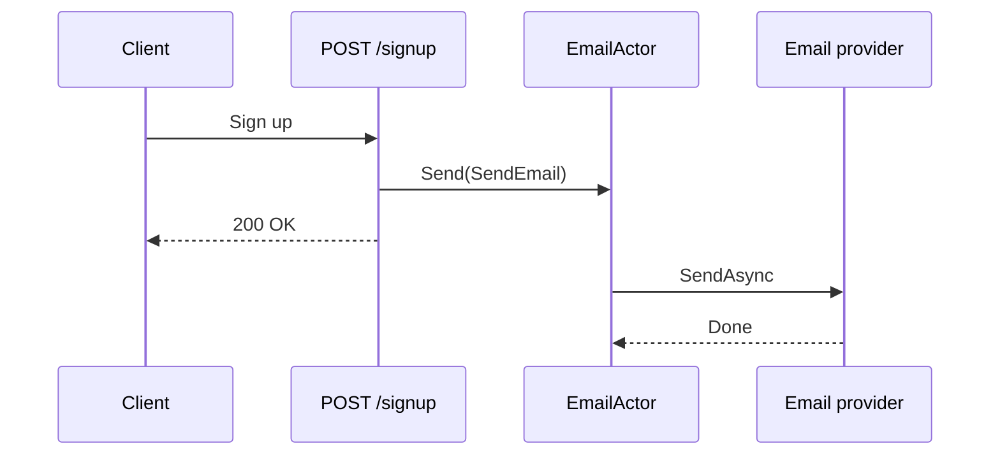

# Send emails in the background

Sending an email through SMTP or a provider API often takes hundreds of milliseconds, sometimes seconds. If an endpoint awaits that call, the user waits too, and a slow provider makes your whole API slow. The usual shortcut, `_ = Task.Run(() => SendAsync(...))`, returns quickly but has no limit on concurrent sends, loses exceptions, and nothing waits for it when the app stops.

An actor gives you a small, explicit queue instead. The endpoint calls `Send`, which puts the message in the actor's inbox and returns at once. The actor sends the emails one at a time in the background, logs failures, and can drain its inbox when the app stops.



The response leaves before the email does. The provider's latency no longer appears in your endpoint's latency.

## Define the message and the actor

The message carries everything the actor needs to send the email:

```csharp
public sealed record SendEmail(string To, string Subject, string Body);
```

`IEmailClient` stands for your own wrapper around SMTP or a provider SDK:

```csharp
public interface IEmailClient
{
    Task SendAsync(string to, string subject, string body);
}
```

The actor implements `IActor<SendEmail>`, because the endpoint does not wait for a result:

```csharp
using Microsoft.Extensions.Logging;
using Nixie;

public sealed class EmailActor : IActor<SendEmail>
{
    private readonly IEmailClient emailClient;
    private readonly ILogger<EmailActor> logger;

    public EmailActor(IEmailClient emailClient, ILogger<EmailActor> logger)
    {
        this.emailClient = emailClient;
        this.logger = logger;
    }

    public async Task Receive(SendEmail message)
    {
        try
        {
            await emailClient.SendAsync(message.To, message.Subject, message.Body);
        }
        catch (Exception ex)
        {
            logger.LogError(ex, "Could not send email to {To}", message.To);
        }
    }
}
```

Nixie builds the actor through your `IServiceProvider`, so `IEmailClient` and the logger come from the container. See [Dependency injection and logging](../patterns/dependency-injection).

## Wire it into ASP.NET Core

Register the actor system and the actor reference as singletons. The endpoint then receives the typed reference like any other service:

```csharp
using Nixie;

WebApplicationBuilder builder = WebApplication.CreateBuilder(args);

builder.Services.AddSingleton<IEmailClient, SmtpEmailClient>();

builder.Services.AddSingleton(sp => new ActorSystem(
    sp,
    sp.GetRequiredService<ILoggerFactory>().CreateLogger("Nixie")));

builder.Services.AddSingleton<IActorRef<EmailActor, SendEmail>>(sp =>
    sp.GetRequiredService<ActorSystem>().Spawn<EmailActor, SendEmail>("emails"));

builder.Services.AddHostedService<ActorSystemShutdown>();

WebApplication app = builder.Build();

app.MapPost("/signup", (SignupRequest request, IActorRef<EmailActor, SendEmail> emails) =>
{
    // Create the account here.

    emails.Send(new SendEmail(request.Email, "Welcome!", "Thanks for signing up."));

    return Results.Ok();
});

app.Run();

public sealed record SignupRequest(string Email);
```

The hosted service drains the actor's inbox when the app stops, so emails that were already accepted still go out:

```csharp
using Nixie;

public sealed class ActorSystemShutdown(ActorSystem system) : IHostedService
{
    public Task StartAsync(CancellationToken cancellationToken) => Task.CompletedTask;

    public Task StopAsync(CancellationToken cancellationToken) =>
        system.GracefulShutdownAll(TimeSpan.FromSeconds(10));
}
```

Keep the wait shorter than the host's `HostOptions.ShutdownTimeout`, or the host stops waiting first.

## Retry failed sends

Nixie does not retry a failed message. You can retry from the actor itself: schedule the same message again with a delay. The actor stays free to send other emails while the retry waits.

```csharp
using Microsoft.Extensions.Logging;
using Nixie;

public sealed record SendEmail(string To, string Subject, string Body, int Attempt = 1);

public sealed class EmailActor : IActor<SendEmail>
{
    private const int MaxAttempts = 3;

    private readonly IActorContext<EmailActor, SendEmail> context;
    private readonly IEmailClient emailClient;
    private readonly ILogger<EmailActor> logger;

    public EmailActor(
        IActorContext<EmailActor, SendEmail> context,
        IEmailClient emailClient,
        ILogger<EmailActor> logger)
    {
        this.context = context;
        this.emailClient = emailClient;
        this.logger = logger;
    }

    public async Task Receive(SendEmail message)
    {
        try
        {
            await emailClient.SendAsync(message.To, message.Subject, message.Body);
        }
        catch (Exception ex) when (message.Attempt < MaxAttempts)
        {
            logger.LogWarning(ex, "Attempt {Attempt} to email {To} failed", message.Attempt, message.To);

            context.ActorSystem.ScheduleOnce(
                context.Self,
                message with { Attempt = message.Attempt + 1 },
                TimeSpan.FromSeconds(30 * message.Attempt));
        }
        catch (Exception ex)
        {
            logger.LogError(ex, "Gave up on email to {To}", message.To);
        }
    }
}
```

Nixie passes the [actor context](../actors/context) and resolves the other constructor parameters from the container. A scheduled retry lives only in memory: if the app stops before the delay ends, the retry is lost.

## Send several emails at once

One actor sends one email at a time. If each send takes 500 ms, one actor handles about two emails per second. To send in parallel, put several copies of the actor behind a [router](../patterns/routers). A balancing router suits email well, because provider latency varies from one send to the next:

```csharp
using Nixie;
using Nixie.Routers;

builder.Services.AddSingleton<IActorRef<BalancingActor<EmailActor, SendEmail>, SendEmail>>(sp =>
    sp.GetRequiredService<ActorSystem>().CreateBalancingRouter<EmailActor, SendEmail>(
        "emails", instances: 4));
```

Endpoints then take `IActorRef<BalancingActor<EmailActor, SendEmail>, SendEmail>` instead of the single actor's reference. The number of routees is your concurrency limit: four routees never send more than four emails at the same time. That protects the provider's rate limits, which `Task.Run` does not.

## Limit the backlog

If the provider goes down, emails pile up in the inbox. A bounded inbox caps that backlog. When it is full, `Send` on a fire-and-forget actor throws `ActorBusyException`, and nothing is enqueued:

```csharp
builder.Services.AddSingleton<IActorRef<EmailActor, SendEmail>>(sp =>
    sp.GetRequiredService<ActorSystem>().SpawnWithOptions<EmailActor, SendEmail>(
        "emails",
        new ActorRunnerOptions { MaxInboxSize = 10_000 }));

app.MapPost("/signup", (SignupRequest request, IActorRef<EmailActor, SendEmail> emails) =>
{
    try
    {
        emails.Send(new SendEmail(request.Email, "Welcome!", "Thanks for signing up."));
    }
    catch (ActorBusyException)
    {
        return Results.StatusCode(StatusCodes.Status503ServiceUnavailable);
    }

    return Results.Ok();
});
```

In Nixie 1.2.5, routers take no options, so a router's own inbox has no limit. If you need a bounded backlog, use a single bounded actor as shown. See [Backpressure and admission](../patterns/backpressure).

## Important considerations

- **Emails in the inbox live only in memory.** A crash, a deploy that kills the process, or a graceful shutdown that reaches its time limit loses them. For email that must be sent, such as a receipt, store it first (for example, with an outbox table) and use the actor only to send what is stored.
- **`GracefulShutdownAll` waits for queued messages.** If the inbox is already empty, it does not wait for an email that the actor is sending at that moment.
- **The handler runs outside the HTTP request.** `HttpContext` is not available, and `AsyncLocal` values do not flow into `Receive`. Put everything the actor needs, such as a correlation ID or the user's locale, in the message.
- **The actor lives as long as the actor system.** Nixie creates it from the root service provider. Do not inject scoped services, such as an EF Core `DbContext`, into the constructor. Inject `IServiceScopeFactory` and create a scope for each message instead.
- **A slow send holds the inbox.** The actor awaits each send before it starts the next one. Set a timeout on your email client, so one stuck connection does not stop all email.

## Related topics

- [Fire-and-forget actors](../actors/fire-and-forget)
- [Behavior and guarantees](../actors/behavior)
- [Lifecycle and scheduling](../patterns/lifecycle-and-scheduling)
- [Routers](../patterns/routers)
