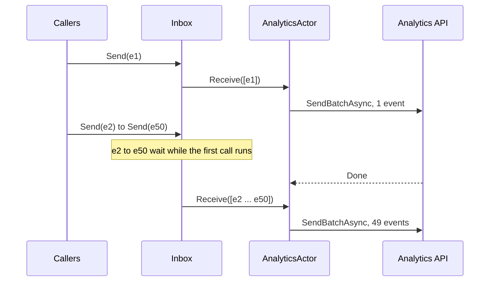

# Batch analytics events

Analytics events are small and frequent: a page view, a click, a search. Sending each event in its own HTTP call or database insert costs a round trip per event, and under load those round trips add up to more time than the work itself. Most analytics APIs and databases accept many events in one call, which is far cheaper per event.

An aggregate actor batches for you. Callers send single events with `Send`. While the actor writes one batch, new events wait in its inbox, and the next call to `Receive` gets all of them in one list. You write no buffer, no lock, and no flush timer.

## Define the event and the actor

The event is a class or record. Aggregate actors in Nixie 1.2.5 accept class messages only.

```csharp
public sealed record TrackEvent(string Name, string UserId, DateTimeOffset OccurredAt);
```

`IAnalyticsClient` stands for your own client for the analytics API or database:

```csharp
public interface IAnalyticsClient
{
    Task SendBatchAsync(IReadOnlyList<TrackEvent> events);
}
```

The actor implements `IActorAggregate<TrackEvent>`. Its `Receive` method takes a `List<TrackEvent>` instead of one event:

```csharp
using Microsoft.Extensions.Logging;
using Nixie;

public sealed class AnalyticsActor : IActorAggregate<TrackEvent>
{
    private const int MaxBatchSize = 500;

    private readonly IAnalyticsClient client;
    private readonly ILogger<AnalyticsActor> logger;

    public AnalyticsActor(IAnalyticsClient client, ILogger<AnalyticsActor> logger)
    {
        this.client = client;
        this.logger = logger;
    }

    public async Task Receive(List<TrackEvent> events)
    {
        foreach (TrackEvent[] chunk in events.Chunk(MaxBatchSize))
        {
            try
            {
                await client.SendBatchAsync(chunk);
            }
            catch (Exception ex)
            {
                logger.LogError(ex, "Dropped {Count} analytics events", chunk.Length);
            }
        }
    }
}
```

`Chunk` splits a large batch to respect the API's limit on events per call. Nixie does not cap the batch size.

## Wire it into ASP.NET Core

Register the actor reference as a singleton and send events from your endpoints:

```csharp
using Nixie;

WebApplicationBuilder builder = WebApplication.CreateBuilder(args);

builder.Services.AddSingleton<IAnalyticsClient, HttpAnalyticsClient>();

builder.Services.AddSingleton(sp => new ActorSystem(
    sp,
    sp.GetRequiredService<ILoggerFactory>().CreateLogger("Nixie")));

builder.Services.AddSingleton<IActorRefAggregate<AnalyticsActor, TrackEvent>>(sp =>
    sp.GetRequiredService<ActorSystem>().SpawnAggregate<AnalyticsActor, TrackEvent>("analytics"));

WebApplication app = builder.Build();

app.MapGet("/products/{id}", (
    string id,
    string userId,
    IActorRefAggregate<AnalyticsActor, TrackEvent> analytics) =>
{
    analytics.Send(new TrackEvent("product_viewed", userId, DateTimeOffset.UtcNow));

    return Results.Ok(new { id });
});

app.Run();
```

`Send` only enqueues the event, so tracking adds almost nothing to the request. To send the remaining events when the app stops, call `GracefulShutdownAll` from a hosted service, as shown in [Send emails in the background](./background-emails#wire-it-into-aspnet-core).

## How batches form

The actor takes every event that is waiting in its inbox, passes them to `Receive` as one list, and awaits the call. Events that arrive during that call wait for the next batch.



So the batch size follows the load:

- With little traffic, batches are small, often one event, and events go out almost at once.
- With heavy traffic, batches grow. The actor still makes about one call per API round trip, however many events arrive.

There is no time window and no minimum batch size. If you must send on a fixed interval, for example every five seconds, use a fire-and-forget actor that adds events to a list, and a [periodic timer](../patterns/lifecycle-and-scheduling#timers) that sends it a flush message.

## Shed events under overload

If the analytics API is slow or down, events pile up in the inbox. Analytics is usually best effort, so dropping events is better than running out of memory. Bound the inbox with `SpawnAggregateWithOptions`. When it is full, `Send` throws `ActorBusyException` and enqueues nothing:

```csharp
builder.Services.AddSingleton<IActorRefAggregate<AnalyticsActor, TrackEvent>>(sp =>
    sp.GetRequiredService<ActorSystem>().SpawnAggregateWithOptions<AnalyticsActor, TrackEvent>(
        "analytics",
        new ActorRunnerOptions { MaxInboxSize = 50_000 }));
```

```csharp
try
{
    analytics.Send(new TrackEvent("product_viewed", userId, DateTimeOffset.UtcNow));
}
catch (ActorBusyException)
{
    // The inbox is full. Drop the event: analytics must not fail the request.
}
```

See [Backpressure and admission](../patterns/backpressure).

## Important considerations

- **Do not keep the list.** Nixie reuses the `List<TrackEvent>` after `Receive` returns. Copy it if you need the events later.
- **A failure affects the whole batch.** If `Receive` throws, Nixie logs the exception and the batch is gone. Nixie does not retry it. Catch exceptions inside `Receive`, as the example does for each chunk.
- **Events in the inbox live only in memory.** A crash or a deploy that kills the process loses them. Use a durable queue if you cannot lose events.
- **`GracefulShutdownAll` waits for queued events.** If the inbox is already empty, it does not wait for a batch that `Receive` is sending at that moment.
- **Order is preserved.** One actor sends one batch at a time, in the order the events entered the inbox.
- **Lifecycle APIs are limited.** In Nixie 1.2.5, aggregate actors have no `Get` lookup, no per-actor `Shutdown` or `GracefulShutdown`, and no timers. Keep the reference in your container, and stop the actor with `GracefulShutdownAll`.

## Related topics

- [Struct and aggregate actors](../patterns/struct-and-aggregate-actors)
- [Behavior and guarantees](../actors/behavior)
- [Backpressure and admission](../patterns/backpressure)
- [Send emails in the background](./background-emails)
